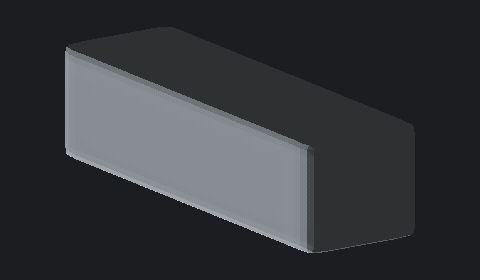
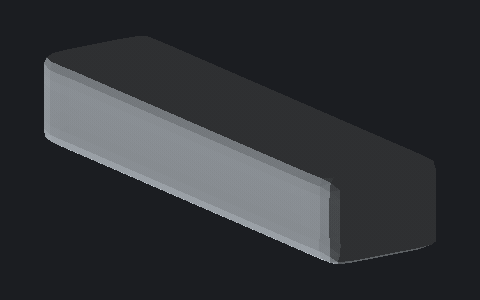
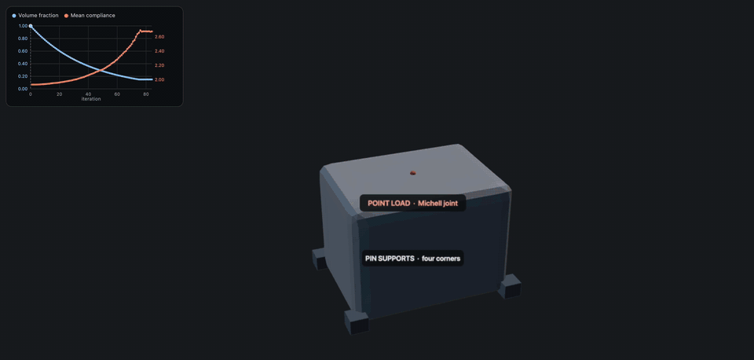
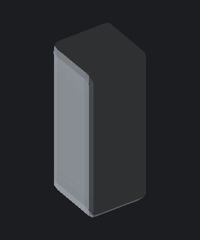

# BESO

Sparse three-dimensional topology optimization using the
bi-directional evolutionary structural optimization (BESO) method.

This project began as the software component of the undergraduate thesis
_A comparison of topology optimization methods for the design of a cantilever
beam_. The current codebase rebuilds the original prototype as an installable,
tested Python package while preserving the thesis method.


## What works

- Structured 3D meshes of eight-node hexahedral elements
- Isotropic linear-elastic finite-element analysis with 2x2x2 Gauss integration
- Sparse global stiffness assembly and sparse direct solution
- Compliance-based soft-kill BESO with spatial and iteration filtering
- A cantilever benchmark, a Xie-style 3D bridge, a Michell space truss, a torsion tower, and a command-line interface
- ParaView-compatible VTK output
- Numerical checks against Euler-Bernoulli beam theory

The original 2019 prototype remains in the top level of `src/` for historical
reference. The maintained implementation is in `src/beso/`.

## Quick start

Python 3.11 or newer is required.

```bash
python3 -m venv .venv
source .venv/bin/activate
python -m pip install -e ".[dev]"
pytest
beso
```

The default command optimizes a `24 x 6 x 6` cantilever to a 20% volume
fraction. A faster example is:

```bash
beso \
  --nelx 12 --nely 4 --nelz 4 \
  --volume 0.30 \
  --max-iterations 70 \
  --output output/demo
```

For larger meshes, use a coarse-to-fine continuation. The transferred topology
is thickened to twice the target volume before fine optimization so it can
relocate material instead of remaining trapped at the coarse design:

```bash
beso \
  --nelx 30 --nely 15 --nelz 8 \
  --volume 0.15 --max-iterations 130 \
  --coarse-factor 2 \
  --output output/multiresolution
```

The output directory contains:

- `design-solid.vtk`: solid elements only, ready to open in ParaView
- `design.vtk`: the complete domain with a cell-density field
- `coarse-design-solid.vtk`: the coarse result when `--coarse-factor` is used
- `summary.json`: parameters, convergence state, displacement, compliance, and
  detailed assembly/solve/postprocessing timing

Add `--snapshot-every 1` to write a smoothed STL at the solid starting beam and
every later iteration, plus `index.html` for playback:

```bash
beso \
  --nelx 40 --nely 12 --nelz 20 \
  --length 40 --width 12 --height 20 \
  --volume 0.15 \
  --young-modulus 200e9 --poisson-ratio 0.4 \
  --load -1000 --evolution-rate 0.01 \
  --filter-mode node --filter-radius 1.5 \
  --max-iterations 250 \
  --snapshot-every 1 \
  --output output/cantilever-history
python -m http.server --directory output/cantilever-history 8000
```

Run `beso --help` for all mesh, material, load, filter, and convergence options.

## Examples

The thesis cantilever, a Xie-style bridge, a Michell space truss, and a
torsion tower live in `examples/`. They write STL iteration history and an
HTML viewer. The GIFs below are looping playback of those histories. The
Michell truss, torsion, and cantilever clips are screen recordings of the viewer
(supports, loads, and the compliance / volume chart). Rebuild a raster GIF
from STL frames with `beso-animate`.

```bash
./examples/cantilever.sh
./examples/bridge.sh
./examples/truss.sh
./examples/torsion.sh
python -m http.server --directory output/examples/torsion 8000
```



The wall at `x = 0` is clamped. The default load is the free-end **bottom-edge**.



`--problem bridge` fixes both bottom end-edges as abutments, keeps a live
top-layer deck, and by default puts a three-axle convoy on the centre roadway.



`--problem truss` pins the four base corners and hangs a point load from the
roof centre. Use `--load-placement offset` or `span` for an edge load or two
ridge joints.



`--problem torsion` pins the four base corners and applies a roof **force
couple** on a live cap plate. The usual result is a helix. Use
`--load-placement diagonal` or `spin` for opposite-corner or four-tangent
twists.

Rebuild a GIF from any history folder:

```bash
beso-animate output/examples/torsion --output docs/media/torsion.gif
```

See `examples/README.md` for faster smoke commands.


## Printable STL

Convert any completed output directory without rerunning the optimization:

```bash
beso-surface output/demo
```

This pads and smooths the binary density field, extracts a marching-cubes
isosurface, applies volume-preserving Taubin smoothing, removes detached
fragments, verifies that the result is watertight, and writes
`design-smoothed.stl`. Use `--sigma` and `--smoothing-iterations` to control the
finish. Physical dimensions become STL dimensions, so use millimetres when
configuring a design intended for printing.

## Optimize an existing STL

Import a watertight STL as a connected voxel design domain:

```bash
beso-import-stl model.stl --pitch 4 --output output/imported
```

The import stores the complete domain and separate masks for disconnected STL
bodies. Optimize it while preserving selected bodies and bottom contact layers:

```bash
beso-optimize-domain output/imported \
  --output output/optimized \
  --volume 0.70 \
  --protect-body 2 --protect-bottom-layers 2 \
  --load-body 2 --vertical-load -1 --lateral-load 0.3
```

Add `--snapshot-every 1` to write a smoothed STL at the initial design and every
iteration. Open the HTML scrubber over HTTP so the browser can load those
surfaces:

```bash
python -m http.server --directory output/optimized 8000
```

Then visit `http://localhost:8000/index.html` and press Play. The viewer shows
the marching-cubes STL sequence, not the voxel grid.

The VTK and watertight STL outputs retain material only inside the imported
shape. Loads are normalized comparative inputs unless calibrated engineering
loads and material properties are supplied.

## Validation

The test suite checks mesh connectivity, element rigid-body modes, stiffness
symmetry and positive semidefiniteness, force/displacement consistency, target
volume selection, VTK export, and the CLI.

For a `4 x 1 x 1` cantilever with `E = 1000`, the refined 3D model predicts a
tip displacement within 5% of the Euler-Bernoulli result:

```text
analytical: 0.256
3D FEA:     0.258
```

This establishes a useful baseline, but does not yet constitute full
verification of the optimizer. Published BESO benchmark geometries and
mesh-independence studies should be added before using results for engineering
decisions.

## Current limitations

- The CLI currently provides cantilever, bridge, truss, and torsion load cases and one material.
- The optimizer returns the lowest-compliance near-target iteration because a
  discrete voxel design cannot always represent the requested fraction exactly.
  The actual fraction is always reported in `summary.json`.
- Very coarse meshes can lose a load path near the target volume. Connectivity
  constraints and non-design regions around loads and supports are the next
  correctness priority.
- STL watertightness is checked, but minimum wall thickness, overhangs, and
  printer-specific tolerances still need validation in a slicer.
- There is no graphical model editor. Iteration history can be scrubbed in a
  local HTML viewer after `--snapshot-every` is used.

## Improvement roadmap

1. Validate against published 3D BESO compliance and topology benchmarks.
2. Add protected load/support regions and solid-connectivity checks.
3. Support multiple loads, boundary-condition regions, and passive elements
   through a versioned problem file.
4. Add minimum-feature and manufacturing constraints to printable surfaces.
5. Profile larger problems, add iterative solvers and preconditioning, then
   evaluate GPU backends based on measured bottlenecks.
6. Add an interactive viewer only after the numerical contract is stable.

The sparse CPU solver is intentional: it addresses the original prototype's
largest memory issue and provides a testable reference implementation for any
future accelerated backend.
